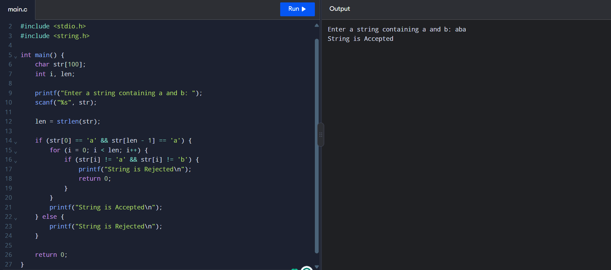

# Experiment-1: String Starts and Ends with 'a'

## Aim
To check whether a string containing only `a` and `b` starts and ends with `a`.

## Source Code

```c

#include <stdio.h>
#include <string.h>

int main() {
    char str[100];
    int i, len;

    printf("Enter a string containing a and b: ");
    scanf("%s", str);

    len = strlen(str);

    if (str[0] == 'a' && str[len - 1] == 'a') {
        for (i = 0; i < len; i++) {
            if (str[i] != 'a' && str[i] != 'b') {
                printf("String is Rejected\n");
                return 0;
            }
        }
        printf("String is Accepted\n");
    } else {
        printf("String is Rejected\n");
    }

    return 0;
}
```

## Sample Input and Output

```text
Enter a string containing a and b: aba
String is Accepted
```

### Output Screenshot


