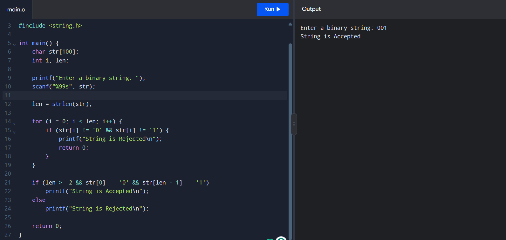

# Experiment-2: Binary String Starts with 0 and Ends with 1

## Aim
To check whether a binary string contains only `0` and `1`, starts with `0`, and ends with `1`.

## Source Code

```c

#include <stdio.h>
#include <string.h>

int main() {
    char str[100];
    int i, len;

    printf("Enter a binary string: ");
    scanf("%99s", str);

    len = strlen(str);

    for (i = 0; i < len; i++) {
        if (str[i] != '0' && str[i] != '1') {
            printf("String is Rejected\n");
            return 0;
        }
    }

    if (len >= 2 && str[0] == '0' && str[len - 1] == '1')
        printf("String is Accepted\n");
    else
        printf("String is Rejected\n");

    return 0;
}
```

## Sample Input and Output

```text
Enter a binary string: 001
String is Accepted
```

### Output Screenshot


