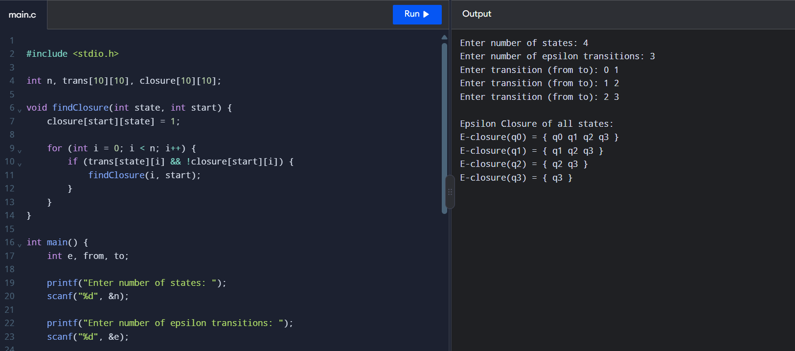

# Experiment-3: Epsilon Closure of an NFA

## Aim
To calculate the epsilon closure of each state using the given epsilon transitions.

## Source Code

```c

#include <stdio.h>

int n, trans[10][10], closure[10][10];

void findClosure(int state, int start) {
    closure[start][state] = 1;

    for (int i = 0; i < n; i++) {
        if (trans[state][i] && !closure[start][i]) {
            findClosure(i, start);
        }
    }
}

int main() {
    int e, from, to;

    printf("Enter number of states: ");
    scanf("%d", &n);

    printf("Enter number of epsilon transitions: ");
    scanf("%d", &e);

    for (int i = 0; i < e; i++) {
        printf("Enter transition (from to): ");
        scanf("%d %d", &from, &to);
        trans[from][to] = 1;
    }

    for (int i = 0; i < n; i++) {
        findClosure(i, i);
    }

    printf("\nEpsilon Closure of all states:\n");

    for (int i = 0; i < n; i++) {
        printf("E-closure(q%d) = { ", i);

        for (int j = 0; j < n; j++) {
            if (closure[i][j]) {
                printf("q%d ", j);
            }
        }

        printf("}\n");
    }

    return 0;
}
```

## Sample Input and Output

```text
Enter number of states: 4
Enter number of epsilon transitions: 3
Enter transition (from to): 0 1
Enter transition (from to): 1 2
Enter transition (from to): 2 3

Epsilon Closure of all states:
E-closure(q0) = { q0 q1 q2 q3 }
E-closure(q1) = { q1 q2 q3 }
E-closure(q2) = { q2 q3 }
E-closure(q3) = { q3 }
```

### Output Screenshot


