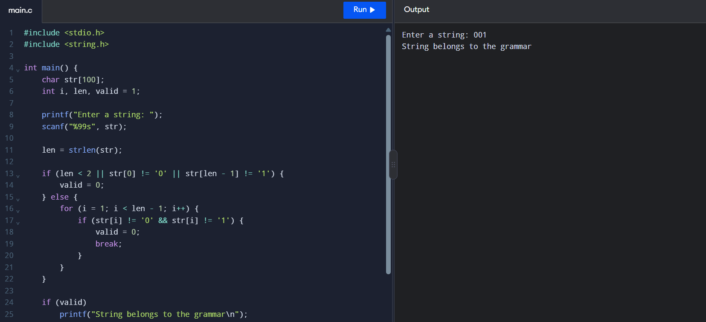

# Experiment-4: Check String Membership in a Binary Grammar

## Aim
To check whether a binary string starts with `0`, ends with `1`, and has only binary symbols in between.

## Source Code

```c

#include <stdio.h>
#include <string.h>

int main() {
    char str[100];
    int i, len, valid = 1;

    printf("Enter a string: ");
    scanf("%99s", str);

    len = strlen(str);

    if (len < 2 || str[0] != '0' || str[len - 1] != '1') {
        valid = 0;
    } else {
        for (i = 1; i < len - 1; i++) {
            if (str[i] != '0' && str[i] != '1') {
                valid = 0;
                break;
            }
        }
    }

    if (valid)
        printf("String belongs to the grammar\n");
    else
        printf("String does not belong to the grammar\n");

    return 0;
}
```

## Sample Input and Output

```text
Enter a string: 001
String belongs to the grammar
```

### Output Screenshot


